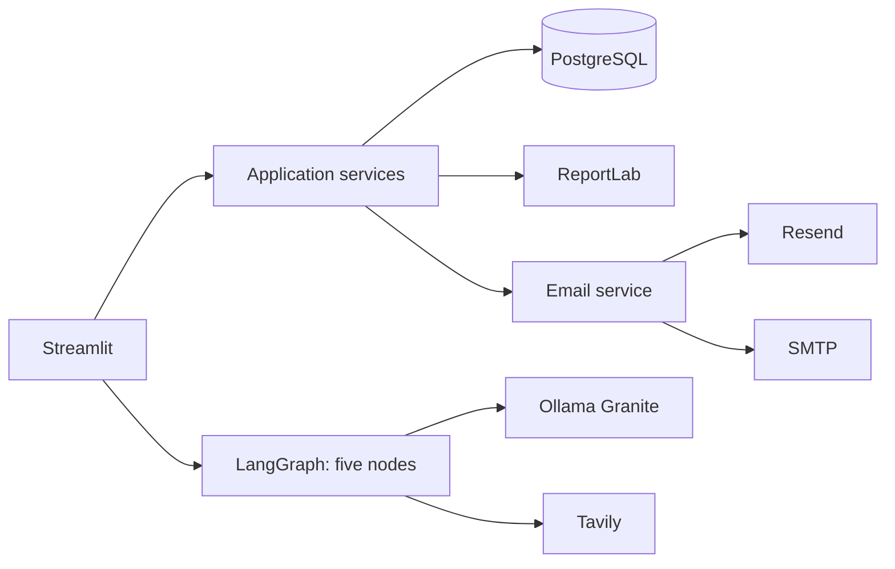

# EverAfter AI

A modular Streamlit wedding planner using PostgreSQL/SQLAlchemy, bcrypt, ReportLab, LangGraph, Ollama Granite and Tavily. Includes shared wedding projects, membership authorization, budget/task/vendor records, versioned PDFs, and confirmed PDF email delivery via Resend (recommended) or SMTP.

## Setup (macOS)
```bash
python3.12 -m venv .venv
source .venv/bin/activate
python -m pip install --upgrade pip
pip install -r requirements.txt
pip install -e .
cp .env.example .env
docker compose up -d
ollama pull granite3.3:8b
alembic upgrade head
streamlit run app.py
```
Set `SECRET_KEY`, `DATABASE_URL`, and provider credentials in `.env`. Tavily and Ollama are required only for AI research/planning. PostgreSQL is required for the documented deployment.

## Email delivery
Resend is the recommended production provider. Verify a sender domain at Resend, create an API key, then set:
```env
EMAIL_PROVIDER=resend
RESEND_API_KEY=re_...
EMAIL_FROM="EverAfter AI <wedding@your-domain.com>"
EMAIL_MAX_ATTACHMENT_MB=15
```
SMTP alternative:
```env
EMAIL_PROVIDER=smtp
SMTP_HOST=smtp.example.com
SMTP_PORT=587
SMTP_USERNAME=...
SMTP_PASSWORD=...
SMTP_USE_TLS=true
EMAIL_FROM="EverAfter AI <wedding@example.com>"
```
In Wedding Plan PDF, select the account email or verified partner, tick the confirmation checkbox, then click **Send PDF to Email**. The app regenerates the newest PDF immediately before sending. No email is sent without confirmation. Email history records recipient, version, timestamp, provider and sent/failed status. Credentials are environment-only; never commit `.env`.

## Architecture

Five LangGraph nodes: Supervisor, Venue Research, Vendor Research, Budget Advisor and Wedding Coordinator. Python calculates budget figures; the LLM only explains them. Research results retain source URLs and are not bookings.

## Tests
```bash
pytest -q
ruff check .
```

## Security / deployment notes
Passwords are bcrypt hashes; project data access is membership-scoped; partner email delivery requires accepted membership and verified email. Use HTTPS, managed secrets, rate limiting, database backups, real email-verification workflow and private object storage before production. Location hierarchy, full invitation web flow, vendor package comparisons, and richer dashboard reporting are extension points in this initial runnable codebase.


## Provider research and selection workflow (updated)

The **Find providers** tab is category-first. Choose a category (for example Wedding venue,
Photography, Catering, Kerala sadya, Decoration or Bridal makeup), enter the search location
and any extra requirements, then run the search. The Tavily-backed research node returns
source URLs and snippets. Results are persisted against the current wedding project.

For each provider you can:
- Open the original source website.
- Inspect the search summary and available package/contact information.
- Mark it Not selected, Shortlisted, Selected, Quotation received or Booked.
- Save verified package details, contact information, a quotation amount and personal notes.

**Important:** a search snippet is not a confirmed quote or availability. Unpublished prices
are explicitly marked as not published. Confirm prices, dates, inclusions and contracts with
the provider before booking.

The **My choices** tab shows shortlisted and selected providers. The **PDF & email** tab
generates a new PDF version using the saved wedding profile, selected providers, package notes,
quotation amounts, expenses and checklist. Shortlisted providers are clearly separated from
selected providers in the PDF.

### Existing database upgrade

For an existing PostgreSQL database, back up first, then run:

```bash
alembic upgrade head
```

For a brand-new local database, the app creates tables on startup. Configure `.env` from
`.env.example`, especially `TAVILY_API_KEY`, `DATABASE_URL`, and Ollama settings.
